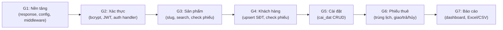

# Kế hoạch triển khai Backend — MiuMiu Rent Stuff

> **Trạng thái:** Chờ duyệt  
> **Ngày:** 24/11/2026  
> **Người lập:** Antigravity (Bước 1 — phân tích & kế hoạch)

---

## 1. Mục tiêu

Hoàn thiện backend Go theo đúng nghiệp vụ tiệm thuê đồ MiuMiu. Chưa làm frontend. Backend phải đủ 7 giai đoạn: nền tảng → xác thực → sản phẩm → khách hàng → cài đặt → phiếu thuê → báo cáo.

---

## 2. So sánh code hiện có vs. nghiệp vụ

### ✅ Đã có (và dùng được)

| Hạng mục | Mô tả |
|---|---|
| Kết nối DB | GORM + MySQL, connection pool đúng |
| CORS middleware | Có, `Allow-Origin: *` |
| Logger + Recovery | `gin.Default()` tích hợp sẵn |
| Phân trang | `pagination.Paginate()` đúng pattern |
| Model `SanPham` | Đầy đủ trường, validation ozzo |
| Model `KhachHang` | Đầy đủ trường, validation ozzo |
| Model `ThueDo` + `ChiTietThueDo` | Struct có, associations đúng |
| CRUD cơ bản sản phẩm | GetAll (filter trang_thai) + GetByID + Create + Update + Delete |
| CRUD cơ bản khách hàng | GetAll (search) + GetByID + Create + Update + Delete |
| CRUD cơ bản phiếu thuê | GetAll + GetByID + Create (transaction) + Update + Delete |
| Tiền dùng `float64` trong model | ⚠️ Cần đổi sang `decimal.Decimal` |

### ❌ Thiếu hoàn toàn

| Giai đoạn | Hạng mục thiếu |
|---|---|
| **G1 — Nền tảng** | Response helper thống nhất (`response.go`); struct lỗi validation rõ ràng; middleware log có requestID |
| **G2 — Xác thực** | Model `NguoiDung`, handler auth (login/logout/đổi tên/mật khẩu), JWT middleware, bcrypt hash |
| **G3 — Sản phẩm** | Tìm theo mã/tên (hiện chỉ filter `trang_thai`); sắp xếp theo giá thuê; **slug tự sinh** (hiện client phải tự gửi slug); kiểm tra có phiếu trước khi xóa; **không cho sửa SKU nếu đã có phiếu**; API đổi trạng thái Hoàn tất bảo dưỡng; chi tiết kèm lịch sử thuê + doanh thu |
| **G4 — Khách hàng** | Thêm nhanh (upsert theo SĐT); kiểm tra có phiếu trước khi xóa; chi tiết kèm lịch sử thuê |
| **G5 — Cài đặt** | Model `CaiDat`, handler đọc/sửa cài đặt |
| **G6 — Phiếu thuê** | Sinh mã phiếu tự động (DT-0001); **kiểm tra trùng lịch**; tự tính `tong_tien_thue`, `ngay_hen_tra`; tự đổi `trang_thai` sản phẩm trong transaction; **API giao đồ**, **API trả đồ** (chọn từng sản phẩm về Trống/Bảo dưỡng, tính hoàn cọc); **API hủy phiếu**; quy tắc sửa theo trạng thái; **không xóa phiếu**; Quá hạn tự chuyển (tính khi truy vấn); job/scheduler |
| **G7 — Báo cáo** | Dashboard (tổng quan), báo cáo doanh thu, xuất Excel/CSV |

### ⚠️ Sai cần sửa

| Vị trí | Vấn đề | Fix |
|---|---|---|
| `model/san_pham.go` | `GiaGocSanPham`, `GiaThuNgay` dùng `float64` | Đổi sang `decimal.Decimal` hoặc dùng `string` scan; cần thêm thư viện `shopspring/decimal` |
| `model/thue_do.go` | `TongTienThue`, `TienCoc`, `TienPhat` dùng `float64` | Đổi sang `decimal.Decimal` |
| `model/thue_do.go` | `ChiTietThueDo.GiaThuNgay` tên field sai (`GiaThuNgay` thay vì `GiaThueNgay`) — không khớp với DB column `gia_thue_ngay` | Cần kiểm tra lại |
| `handler/thue_do_handler.go` | `Delete` cho xóa phiếu tự do — vi phạm nghiệp vụ (phiếu không được xóa) | Bỏ endpoint DELETE hoặc chặn |
| `handler/san_pham_handler.go` | `Delete` không kiểm tra có phiếu thuê không | Thêm kiểm tra |
| `handler/khach_hang_handler.go` | `Delete` không kiểm tra có phiếu thuê không | Thêm kiểm tra |
| `handler/san_pham_handler.go` | Tìm kiếm chưa hỗ trợ theo mã/tên | Thêm query param `search` |
| `model/san_pham.go` | `CreateSanPhamInput` yêu cầu `slug` bắt buộc — vi phạm nghiệp vụ (slug tự sinh) | Slug không nhận từ client |
| Toàn bộ | Chưa có Auth — mọi API đều public | Thêm JWT middleware |
| `thue_do_handler.go` | Create nhận `ma_phieu_thue` từ client — vi phạm nghiệp vụ (mã tự sinh) | Bỏ field này khỏi input |

---

## 3. Thư viện bổ sung cần thêm

| Thư viện | Lý do | Lệnh |
|---|---|---|
| `golang-jwt/jwt/v5` | JWT token | `go get github.com/golang-jwt/jwt/v5` |
| `shopspring/decimal` | Tiền dùng DECIMAL an toàn | `go get github.com/shopspring/decimal` |
| `gosimple/slug` | Sinh slug từ tên tiếng Việt | `go get github.com/gosimple/slug` |
| `gorilla/websocket` | WebSocket realtime | `go get github.com/gorilla/websocket` |
| `xuri/excelize/v2` | Xuất Excel (G7) | `go get github.com/xuri/excelize/v2` |

> **Lưu ý:** Giữ nguyên Gin, GORM, ozzo-validation — không đổi framework.

---

## 4. Cấu trúc thư mục đề xuất

```
backend/
├── cmd/server/main.go           ← Thêm: start background scheduler
└── internal/
    ├── common/
    │   ├── pagination.go        ← Giữ nguyên
    │   └── response.go          ← [NEW] Response/Error helpers thống nhất
    ├── config/
    │   └── config.go            ← [NEW] Đọc env tập trung (JWT_SECRET, v.v.)
    ├── database/
    │   └── database.go          ← Giữ nguyên
    ├── middleware/
    │   ├── auth.go              ← [NEW] JWT middleware (AuthRequired)
    │   └── request_id.go        ← [NEW] X-Request-ID header
    ├── model/
    │   ├── san_pham.go          ← Sửa: decimal, bỏ slug từ input
    │   ├── khach_hang.go        ← Sửa nhỏ
    │   ├── thue_do.go           ← Sửa: decimal, bỏ ma_phieu_thue từ input
    │   ├── nguoi_dung.go        ← [NEW] Auth model
    │   └── cai_dat.go           ← [NEW] Cài đặt model
    ├── hub/
    │   └── hub.go               ← [NEW] WebSocket broadcast hub
    ├── service/
    │   ├── slug_service.go      ← [NEW] Sinh slug không trùng
    │   ├── ma_phieu_service.go  ← [NEW] Sinh mã phiếu DT-XXXX
    │   ├── thue_do_service.go   ← [NEW] Logic phức tạp: trùng lịch, tính tiền, trạng thái
    │   └── bao_cao_service.go   ← [NEW] Báo cáo, xuất Excel/CSV
    ├── handler/
    │   ├── san_pham_handler.go  ← Sửa: thêm search, slug tự sinh, check trước xóa
    │   ├── khach_hang_handler.go← Sửa: upsert SĐT, check trước xóa
    │   ├── thue_do_handler.go   ← Sửa toàn bộ: giao đồ, trả đồ, hủy, quá hạn
    │   ├── auth_handler.go      ← [NEW] Login, đổi mật khẩu
    │   ├── cai_dat_handler.go   ← [NEW] Đọc/sửa cài đặt
    │   ├── dashboard_handler.go ← [NEW] Tổng quan
    │   └── bao_cao_handler.go   ← [NEW] Báo cáo + xuất file
    └── router/
        └── router.go            ← Sửa: thêm routes mới, nhóm auth-required
```

---

## 5. Danh sách API đề xuất

### 5.1 Auth (`/api/v1/auth`)

| Method | Path | Mô tả | Auth? |
|---|---|---|---|
| POST | `/api/v1/auth/login` | Đăng nhập, trả JWT | ❌ |
| GET | `/api/v1/auth/me` | Thông tin tài khoản hiện tại | ✅ |
| PUT | `/api/v1/auth/me` | Đổi tên / mật khẩu | ✅ |

**Request login:**
```json
{ "email": "admin@miumiu.vn", "mat_khau": "abc123" }
```
**Response:**
```json
{ "data": { "token": "eyJ...", "nguoi_dung": { "id": 1, "ten": "MiuMiu", "email": "..." } } }
```

---

### 5.2 Sản phẩm (`/api/v1/san-pham`)

| Method | Path | Query/Body | Mô tả | Auth? |
|---|---|---|---|---|
| GET | `/` | `search`, `trang_thai`, `sort` (gia_asc/gia_desc), `page`, `limit` | Danh sách, tìm mã/tên, lọc, sắp xếp | ✅ |
| GET | `/:id` | — | Chi tiết + lịch sử thuê + doanh thu | ✅ |
| POST | `/` | JSON (không có slug, không có trang_thai) | Tạo mới, slug tự sinh | ✅ |
| PUT | `/:id` | JSON partial | Sửa (SKU chặn nếu đã có phiếu) | ✅ |
| DELETE | `/:id` | — | Xóa (chặn nếu đã có phiếu) | ✅ |
| PATCH | `/:id/trang-thai` | `{ "trang_thai": 1 }` | Đổi trạng thái (Hoàn tất bảo dưỡng → 1; chặn Đã cho thuê sang Bảo dưỡng) | ✅ |

**Response `GET /:id` (chi tiết):**
```json
{
  "data": {
    "id": 1, "ma_san_pham": "MiuMiu-001", "ten_san_pham": "Áo dài đỏ",
    "slug": "ao-dai-do", "gia_goc_san_pham": "5000000.00",
    "gia_thue_ngay": "150000.00", "trang_thai": 1,
    "so_lan_thue": 12,
    "tong_doanh_thu": "1800000.00",
    "da_thu_hoi_von": true,
    "lich_su_thue": [ { "ma_phieu_thue": "DT-0001", ... } ]
  }
}
```

---

### 5.3 Khách hàng (`/api/v1/khach-hang`)

| Method | Path | Mô tả | Auth? |
|---|---|---|---|
| GET | `/` | Danh sách, `search` (tên/SĐT), phân trang | ✅ |
| GET | `/:id` | Chi tiết + lịch sử thuê (đang thuê + đã trả) | ✅ |
| POST | `/` | Tạo mới | ✅ |
| POST | `/tim-theo-sdt` | Tìm theo SĐT — trả khách cũ nếu có, không tạo mới | ✅ |
| PUT | `/:id` | Sửa thông tin | ✅ |
| DELETE | `/:id` | Xóa (chặn nếu đã có phiếu) | ✅ |

**Request `/tim-theo-sdt`:**
```json
{ "so_dien_thoai": "0912345678", "ten": "Nguyễn Thị A" }
```
**Response:** trả `{ "data": khachHang, "is_new": true/false }`

---

### 5.4 Phiếu thuê (`/api/v1/thue-do`)

| Method | Path | Mô tả | Auth? |
|---|---|---|---|
| GET | `/` | Danh sách, filter `trang_thai`, `khach_hang_id`, `search` (mã phiếu), `page`, `limit` | ✅ |
| GET | `/:id` | Chi tiết đầy đủ | ✅ |
| POST | `/` | Tạo phiếu (1 transaction; sinh mã; tính tiền; kiểm tra trùng lịch; đổi trạng thái SP) | ✅ |
| PUT | `/:id` | Sửa theo quy tắc trạng thái | ✅ |
| POST | `/:id/giao-do` | Giao đồ (Chờ → Đang thuê; SP → Đã cho thuê) | ✅ |
| POST | `/:id/tra-do` | Trả đồ (Đang thuê/Quá hạn → Đã trả; chọn trạng thái từng SP; tính cọc) | ✅ |
| POST | `/:id/huy` | Hủy phiếu (Chờ/Đang → Đã hủy; SP về Trống nếu đã giao) | ✅ |

> ❌ **Không có DELETE** — phiếu không được xóa.

**Request tạo phiếu:**
```json
{
  "khach_hang_id": 5,
  "ngay_bat_dau": "2026-11-25T09:00:00+07:00",
  "so_ngay_thue": 3,
  "loai_coc": 1,
  "tien_coc": 12750000,
  "ghi_chu": "...",
  "chi_tiet": [
    { "san_pham_id": 1 },
    { "san_pham_id": 3 }
  ]
}
```
> Backend tự sinh: `ma_phieu_thue`, `ngay_hen_tra`, `tong_tien_thue`, `gia_thue_ngay` (snapshot), `tien_coc` mỗi SP (gợi ý từ cài đặt)

**Request trả đồ:**
```json
{
  "tien_phat": 50000,
  "ghi_chu": "Trả trễ 1 ngày",
  "san_pham_trang_thai": [
    { "san_pham_id": 1, "trang_thai": 1 },
    { "san_pham_id": 3, "trang_thai": 3 }
  ]
}
```
**Response trả đồ — kèm thông tin cọc:**
```json
{
  "data": { ... phiếu ... },
  "xu_ly_coc": {
    "loai_coc": 1,
    "tien_coc": 12750000,
    "tien_phat": 50000,
    "hoan_lai": 12700000
  }
}
```

---

### 5.5 Cài đặt (`/api/v1/cai-dat`)

| Method | Path | Mô tả | Auth? |
|---|---|---|---|
| GET | `/` | Lấy tất cả cài đặt | ✅ |
| PUT | `/:khoa` | Sửa giá trị theo khóa | ✅ |

---

### 5.6 Dashboard (`/api/v1/dashboard`)

| Method | Path | Mô tả | Auth? |
|---|---|---|---|
| GET | `/` | Tổng quan: phiếu quá hạn, cần trả hôm nay, đặt trước sắp đến, số SP theo trạng thái, doanh thu tháng | ✅ |

**Response:**
```json
{
  "data": {
    "phieu_qua_han": [ ... ],
    "phieu_can_tra_hom_nay": [ ... ],
    "phieu_dat_truoc_sap_den": [ ... ],
    "so_san_pham": { "trong_lich": 10, "da_cho_thue": 5, "dang_bao_duong": 2 },
    "doanh_thu_thang_nay": "5000000.00"
  }
}
```

---

### 5.7 Báo cáo (`/api/v1/bao-cao`)

| Method | Path | Query | Mô tả | Auth? |
|---|---|---|---|---|
| GET | `/doanh-thu` | `thang`, `nam` | Doanh thu theo tháng | ✅ |
| GET | `/phieu-thue` | `trang_thai`, `tu_ngay`, `den_ngay` | Danh sách phiếu báo cáo | ✅ |
| GET | `/hieu-qua-san-pham` | — | Hiệu quả từng sản phẩm | ✅ |
| GET | `/khach-hang` | — | Danh sách khách + số lần thuê | ✅ |
| GET | `/xuat-excel` | `loai` (doanh_thu/phieu_thue/san_pham/khach_hang), + params trên | Xuất Excel | ✅ |
| GET | `/xuat-csv` | tương tự | Xuất CSV | ✅ |

---

## 6. Logic nghiệp vụ quan trọng

### 6.1 Sinh slug không trùng

```go
// service/slug_service.go
func GenerateUniqueSlug(db *gorm.DB, name string) string {
    base := slug.Make(name) // "áo dài đỏ" → "ao-dai-do"
    candidate := base
    for i := 1; ; i++ {
        var count int64
        db.Model(&SanPham{}).Where("slug = ?", candidate).Count(&count)
        if count == 0 { return candidate }
        candidate = fmt.Sprintf("%s-%d", base, i)
    }
}
```

### 6.2 Sinh mã phiếu tự động

```go
// service/ma_phieu_service.go
// SELECT MAX(id) FROM thue_do → pad 4 chữ số
func GenerateMaPhieu(db *gorm.DB) string {
    var maxID uint
    db.Model(&ThueDo{}).Select("COALESCE(MAX(id),0)").Scan(&maxID)
    return fmt.Sprintf("DT-%04d", maxID+1)
}
```

### 6.3 Kiểm tra trùng lịch

```go
// Điều kiện: sản phẩm X có phiếu trạng thái IN(1,2,4) mà khoảng ngày giao nhau với [ngay_bat_dau, ngay_hen_tra]
// (new_start < existing.ngay_hen_tra) AND (new_end > existing.ngay_bat_dau)
db.Joins("JOIN chi_tiet_thue_do ct ON ct.thue_do_id = thue_do.id").
   Where("ct.san_pham_id = ? AND thue_do.trang_thai IN (1,2,4)", sanPhamID).
   Where("thue_do.ngay_bat_dau < ? AND thue_do.ngay_hen_tra > ?", newEnd, newStart).
   First(&conflict)
```

### 6.4 Quá hạn + WebSocket realtime

**Chiến lược:** Dùng **WebSocket** (`gorilla/websocket`) thay cho polling/goroutine thuần.

**Luồng:**
1. Khi `GetAll`/`GetByID`: nếu `trang_thai = 2` và `ngay_hen_tra < NOW()` → UPDATE sang `4`, push WS event.
2. Background goroutine mỗi giờ quét hàng loạt → UPDATE → push WS event cho tất cả client đang kết nối.
3. Client nhận event → tự cập nhật UI mà không cần F5.

**Các sự kiện WebSocket sẽ push:**

| Event `loai` | Khi nào | Data |
|---|---|---|
| `phieu_moi` | Tạo phiếu thành công | object phiếu |
| `phieu_qua_han` | Phát hiện quá hạn | `{ ids: [5,12] }` |
| `phieu_cap_nhat` | Giao/trả/hủy phiếu | object phiếu |
| `san_pham_doi_trang_thai` | Đổi trạng thái SP | `{ id, trang_thai }` |

```go
// internal/hub/hub.go — WS broadcast hub
type Hub struct {
    clients   map[*Client]bool
    broadcast chan []byte
    register  chan *Client
    unregister chan *Client
}

// Endpoint: GET /api/v1/ws (upgrade HTTP → WebSocket, cần JWT)
```

```json
// Server → Client push (ví dụ)
{ "loai": "phieu_qua_han", "data": { "ids": [5, 12] } }
{ "loai": "san_pham_doi_trang_thai", "data": { "id": 3, "trang_thai": 2 } }
```

**Thư viện:** `github.com/gorilla/websocket` — thêm vào `go.mod`.

### 6.5 Tiền dùng decimal

Thêm `github.com/shopspring/decimal`, thay `float64` bằng `decimal.Decimal` trong model, dùng `json:",string"` hoặc custom marshaler. GORM hỗ trợ native với driver MySQL khi dùng kiểu `decimal.Decimal`.

```go
GiaGocSanPham decimal.Decimal `json:"gia_goc_san_pham" gorm:"type:decimal(12,2)"`
```

### 6.6 Tổng tiền thuê

```go
tongGiaThue := sum(chiTiet[i].GiaThueNgay)   // snapshot tại thời điểm tạo
tongTienThue := tongGiaThue * soNgayThue
```

### 6.7 Tiền cọc gợi ý

```go
// Lấy pham_tram_gia_coc từ cai_dat
// tien_coc_goi_y_moi_sp = sp.GiaGocSanPham * phamTram / 100
// Nếu loai_coc == 3 (CCCD) → tien_coc = 0
```

---

## 7. Thứ tự triển khai theo giai đoạn



---

## 8. Thay đổi theo từng giai đoạn (Files)

### Giai đoạn 1 — Nền tảng

#### [NEW] `internal/common/response.go`
Helper: `OK()`, `Created()`, `BadRequest()`, `NotFound()`, `InternalError()`, `ValidationError()`.

#### [NEW] `internal/config/config.go`
Đọc env: `JWT_SECRET`, `JWT_EXPIRY_HOURS`, `APP_PORT`, `GIN_MODE`.

#### [NEW] `internal/middleware/auth.go`
Middleware `AuthRequired`: parse Bearer JWT, set `userID` vào context.

#### [NEW] `internal/middleware/request_id.go`
Thêm `X-Request-ID` header vào mỗi request/response.

#### [MODIFY] `cmd/server/main.go`
Khởi động background goroutine cập nhật Quá hạn.

#### [MODIFY] `internal/router/router.go`
Thêm middleware request_id; nhóm routes cần auth.

---

### Giai đoạn 2 — Xác thực

#### [NEW] `internal/model/nguoi_dung.go`
Struct `NguoiDung`, `LoginInput`, `UpdateProfileInput`.

#### [NEW] `internal/handler/auth_handler.go`
`Login`, `GetProfile`, `UpdateProfile`.

#### [MODIFY] `internal/router/router.go`
Đăng ký `/api/v1/auth/*` routes.

---

### Giai đoạn 3 — Sản phẩm

#### [NEW] `internal/service/slug_service.go`

#### [MODIFY] `internal/model/san_pham.go`
- Đổi `float64` → `decimal.Decimal`
- `CreateSanPhamInput`: bỏ `slug` (tự sinh); bỏ `trang_thai` (mặc định 1)
- Thêm `UpdateSanPhamInput`: chặn sửa `ma_san_pham` nếu có phiếu (logic ở handler)

#### [MODIFY] `internal/handler/san_pham_handler.go`
- `GetAll`: thêm `search` (mã/tên), `sort` (gia_asc/gia_desc)
- `Create`: tự sinh slug
- `Update`: kiểm tra SKU nếu đã có phiếu → chặn
- `Delete`: kiểm tra có phiếu → chặn
- `GetByID`: thêm `so_lan_thue`, `tong_doanh_thu`, `lich_su_thue`
- **[NEW]** `PatchTrangThai`: đổi trạng thái (validate rule)

---

### Giai đoạn 4 — Khách hàng

#### [MODIFY] `internal/handler/khach_hang_handler.go`
- `Delete`: kiểm tra có phiếu → chặn
- **[NEW]** `TimTheoSDT`: upsert
- `GetByID`: thêm lịch sử thuê

---

### Giai đoạn 5 — Cài đặt

#### [NEW] `internal/model/cai_dat.go`
Struct `CaiDat`.

#### [NEW] `internal/handler/cai_dat_handler.go`
`GetAll`, `UpdateByKhoa`.

---

### Giai đoạn 6 — Phiếu thuê

#### [NEW] `internal/service/ma_phieu_service.go`
Sinh mã DT-XXXX.

#### [NEW] `internal/service/thue_do_service.go`
Logic: trùng lịch, tính tiền, đổi trạng thái SP trong transaction.

#### [MODIFY] `internal/model/thue_do.go`
- Đổi `float64` → `decimal.Decimal`
- `CreateThueDoInput`: bỏ `ma_phieu_thue`, bỏ `tong_tien_thue` (tự tính), bỏ `trang_thai` (tự xác định), bỏ `nguoi_dung_id` (lấy từ JWT)
- `ChiTietThueDoInput`: chỉ cần `san_pham_id` (backend tự lấy snapshot giá)
- **[NEW]** `TraDoInput`, `HuyPhieuInput`

#### [MODIFY] `internal/handler/thue_do_handler.go`
- `Create`: dùng service
- `Update`: theo quy tắc trạng thái
- Bỏ `Delete`
- **[NEW]** `GiaoDo`, `TraDo`, `HuyPhieu`

---

### Giai đoạn 7 — Báo cáo

#### [NEW] `internal/service/bao_cao_service.go`

#### [NEW] `internal/handler/dashboard_handler.go`

#### [NEW] `internal/handler/bao_cao_handler.go`

---

## 9. Kế hoạch kiểm tra (Verification)

### Mỗi giai đoạn
```bash
cd backend && go build ./... && go vet ./...
```

### Test tự động (unit test)
Viết `*_test.go` cho logic quan trọng:

| File test | Logic kiểm tra |
|---|---|
| `service/thue_do_service_test.go` | Tính tiền thuê, kiểm tra trùng lịch, chuyển trạng thái |
| `service/slug_service_test.go` | Sinh slug từ tên tiếng Việt, không trùng |
| `service/ma_phieu_service_test.go` | Định dạng DT-XXXX |
| `handler/auth_handler_test.go` | Login đúng/sai mật khẩu |

```bash
cd backend && go test ./... -v
```

### Manual (curl / Postman)
Sau mỗi giai đoạn, test qua curl hoặc HTTP file với các case:
- G2: Login → nhận token → gọi API có auth
- G3: Tạo SP → slug tự sinh → xóa (chặn khi có phiếu)
- G6: Tạo phiếu trùng lịch → phải báo lỗi; tạo phiếu tương lai → Chờ xác nhận; giao đồ → Đang thuê; trả đồ → Đã trả + tính cọc

---

## 10. Câu hỏi đã xác nhận

| # | Câu hỏi | Quyết định |
|---|---|---|
| Q1 | Tạo tài khoản | Người dùng tự thêm thẳng vào database; không có API register |
| Q2 | Realtime | Dùng **WebSocket** (`gorilla/websocket`) thay cho goroutine polling |
| Q3 | Tiền decimal | Dùng `shopspring/decimal` — tránh sai số tài chính |
| Q4 | Hủy phiếu | Tiền cọc/thuê không tự tính; admin ghi chú thủ công |
| Q5 | Sửa SP trong phiếu Chờ | **Replace toàn bộ** `chi_tiet` trong 1 transaction (xóa cũ, insert mới, tính lại tổng) |

---

## 11. Giả định đã chốt

| # | Giả định | Quyết định |
|---|---|---|
| 1 | Cọc mỗi SP = 85% giá gốc (theo mục V nghiệp vụ) | ✅ Giữ nguyên |
| 2 | Hoàn cọc = tiền cọc − tiền phạt | ✅ Áp dụng; nếu âm → hiển thị "Khách cần trả thêm {X}đ" |
| 3 | Quá hạn: tính khi truy vấn + goroutine 1h | ✅ Đủ đơn giản và đáng tin |
| 4 | Mã phiếu: DT-XXXX, lấy MAX(id)+1, pad 4 chữ số | ✅ |
| 5 | Sắp xếp danh sách phiếu: active trước (1,2,4), rồi mới đến 3,5 | ✅ |
